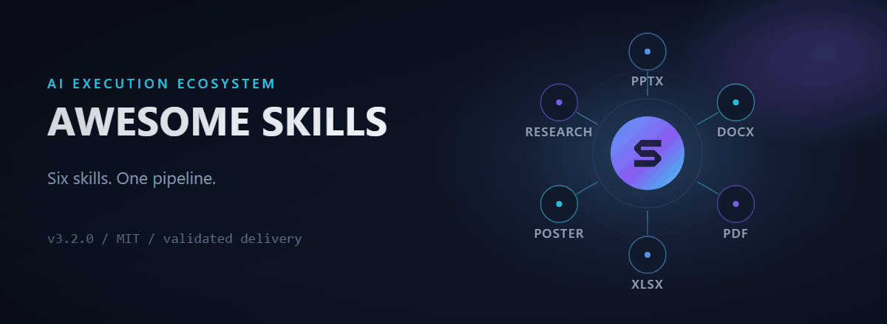
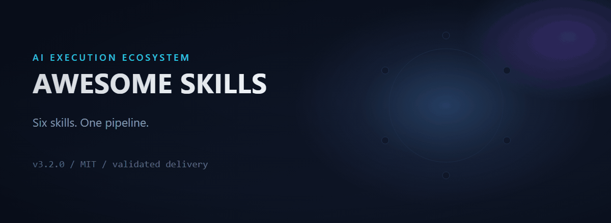
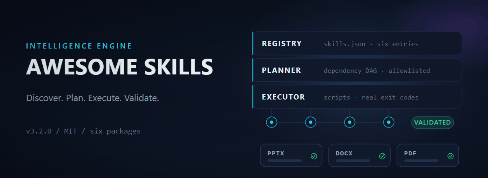
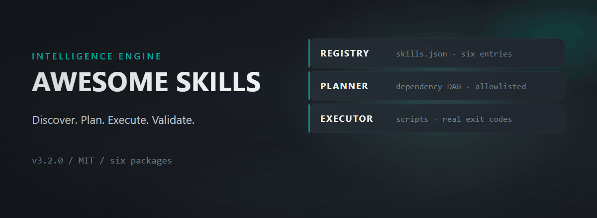
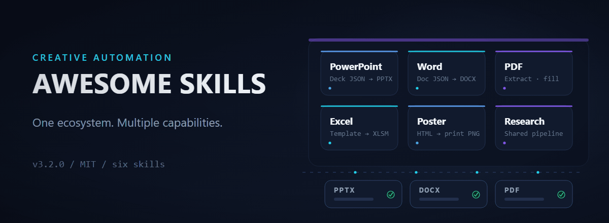
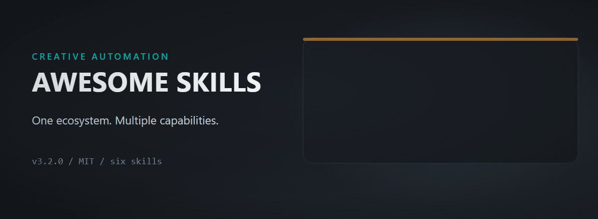

# Three animated hero concepts — Neon Intelligence

Three GitHub-safe motion graphics for the Awesome Skills README, built with the
`beautify-github-readme` Skill: an editable static SVG source, a layer-timing
spec, and a GIF rendered at 30 FPS from that spec, all on one palette.

`README.md` is untouched. Nothing here is embedded or published.

## Palette — Neon Intelligence

| Colour | Hex | Role in the concepts |
| --- | --- | --- |
| Midnight | `#090D1A` | Background base |
| Deep Navy | `#111A2E` | Cards, panels, sockets, decks |
| Electric Violet | `#8B5CF6` | Intelligence: core gradient, primary accent, PDF/Research modules |
| Neon Cyan | `#22D3EE` | Execution: eyebrows, links, rails, connecting paths |
| Ice Blue | `#60A5FA` | Orchestration: pipeline, PowerPoint/Poster modules |
| Soft White | `#F1F5F9` | Titles, card labels |
| Slate | `#94A3B8` | Stage labels, secondary text |
| Neon Mint | `#34D399` | Validation: check marks, VALIDATED badge |

Every one of the eight appears in all three SVGs. The remaining values are navy
tints for hairlines and strokes (`#1B2740`, `#22304D`, `#243253`, `#2A3E66`,
`#33456B`), a Slate shade for metadata (`#64748B`), a dark mint well behind the
checks (`#0B2A24`) and the black vignette stop.

## A · AI orchestration — "AI EXECUTION ECOSYSTEM"

The orchestrator core lights with the Relay S, six skill modules resolve around
it, the cyan links activate, the modules collapse into an ice-blue pipeline row,
and a mint-checked deliverable lands in the core. The orbit ring and module
sockets are static, so no frame reads as an empty panel.

- 1200 × 440 · 150 frames · 30 FPS · 5.00 s · **1.97 MB** · 160 colours
- Layers: 9 animated, 1 reveal · seam pixel-identical between last and first frame

## B · Intelligence engine — "DISCOVER. PLAN. EXECUTE. VALIDATE."

A data packet enters, pings the registry, then four cyan nodes light in sequence
on the executor bus. Paths connect, the mint VALIDATED pill settles, and three
mint-checked deliverables rise. The three-layer deck is static, so every frame
reads as a complete system and the file stays small.

- 1200 × 440 · 150 frames · 30 FPS · 5.00 s · **0.58 MB** · 192 colours
- Layers: 8 animated, 1 reveal · seam pixel-identical

## C · Creative automation — "ONE ECOSYSTEM. MULTIPLE CAPABILITIES."

Six real module cards — PowerPoint, Word, PDF, Excel, Poster, Research — enter the
violet-edged workspace panel on a staggered diagonal, the cyan research stream
runs beneath them, and three mint-checked deliverables assemble.

- 1200 × 440 · 150 frames · 30 FPS · 5.00 s · **0.78 MB** · 192 colours
- Layers: 9 animated, 1 reveal · seam pixel-identical

## Comparison

| Criterion | A · Orchestration | B · Intelligence engine | C · Creative automation |
| --- | --- | --- | --- |
| Cinematic quality | Highest: violet core, radial depth, converging modules | High: restrained, technical, less spectacle | Medium: tidy product board |
| Motion smoothness | Calm ease-outs; six staggered entrances | Calmest; four discrete node activations | Calm; six staggered card entrances |
| Project identity | Strong — Relay S in the core, six named skills | Strongest — registry, planner, executor are the real architecture | Strong — all six categories plus deliverables |
| Typography | 54 px title, 17–18 px labels | 54 px title, 17 px mono detail | 54 px title, 19 px cards, 14 px detail |
| Readability in motion | Labels legible at 900 px; captions small at 360 px | Best at 360 px: short labels, static deck | Good at 900 px; 14 px detail is metadata only |
| Animation file size | 1.97 MB | 0.58 MB | 0.78 MB |
| Palette fidelity | 8/8 colours | 8/8 | 8/8 |
| GitHub compatibility | GIF + static SVG fallback; no CSS, filters or remote refs | Same | Same |
| Mobile appearance | Orbit stays readable; captions become text-like | Deck stacks legibly; nodes stay clear | Cards stay legible; detail lines soften |
| Seamless looping | Verified identical first/last frame | Verified identical | Verified identical |

## Recommendation

**Ship A as the hero.** It is the only concept that states both halves of the
product — six skills and one orchestrated pipeline — inside a single loop, and
the Relay S in the core keeps the repository's identity instead of a generic AI
aesthetic. At 1.97 MB it is just under the 2 MB budget, so it has little headroom.

Keep **B** if a second, smaller visual is wanted further down the page: the most
technically honest architecture, the best mobile legibility, 0.58 MB. **C** is the
right choice only if the README is repositioned as a product page for the six
capabilities rather than the orchestration system.

## Production notes and limits

- **Rasterizer substitution.** The Skill's renderer shells out to `rsvg-convert`
  or macOS `sips`; neither exists on this Windows host. Only that step was
  replaced with headless Chrome (`--default-background-color=00000000` for
  transparency). Layer extraction, timing, easing, chroma flattening, palette
  generation and GIF encoding are the Skill's own `render_motion_gif.py`.
- **GitHub cannot animate SVG.** The GIF is the playable asset; each `hero.svg`
  is the editable source and static fallback. No `<style>`, `foreignObject`,
  script, filter or remote reference is used.
- **Palette.** Dither is off; 160–192 colours. The backgrounds are gradients, so
  banding is possible on some displays. A at 256 colours exceeded 2.1 MB, and at
  192 colours with the earlier, stronger halo it reached 2.14 MB — hence the
  flattened halo and 160 colours for A.
- **Stills are real frames** extracted from each GIF (A at 2.1 s, B at 4.2 s,
  C at 3.9 s), not separately rendered.
- **Not yet watched end to end by a human.** Smoothness was checked by sampling
  frames at 0, 0.8, 2.0, 3.2, 4.0 and 5.0 s and by confirming the seam; the
  animation should be played once before publishing.
