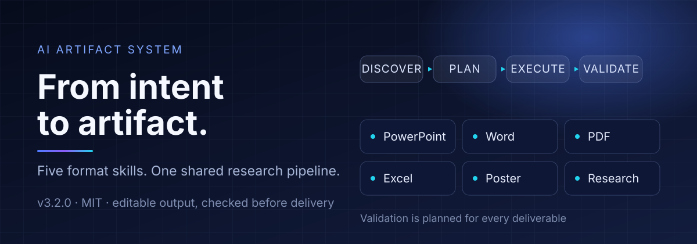
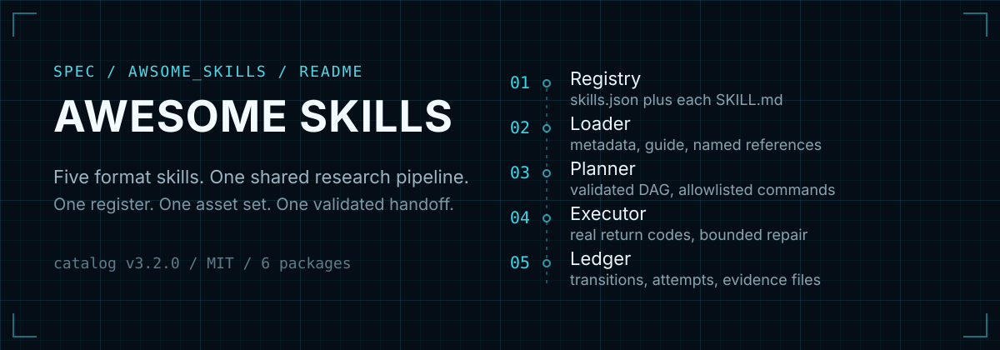
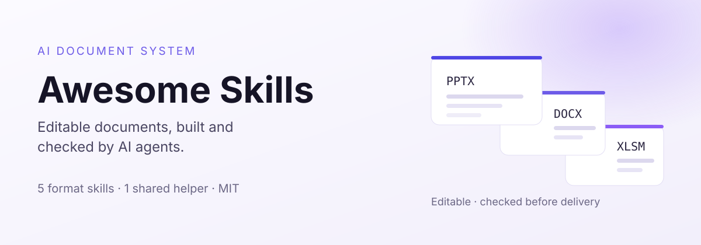

# Hero concepts — three directions

Three static SVG heroes for the Awesome Skills README. None of them is embedded in
the production README yet; `README.md` is unchanged.

Each is a 1200 × 420 `viewBox`, supplies its own background (so it reads on GitHub
light and dark pages), uses only system fonts and plain SVG shapes, and contains
no scripts, filters or external references.

## A · Command center

- **Palette** navy `#070C1C` → `#121C3D`, blue `#4F7BFF`, violet `#8B5CF6`, cyan `#22D3EE`.
- **Job** state the promise and show the pipeline as the product: four stages, six skills, one validation line.
- **Strength** reads as a platform at a glance; the flow explains the orchestrator without prose.

## B · Engineering blueprint

- **Palette** blueprint ink `#050E16`, cyan `#39D7EA`, white `#F2FBFF`.
- **Job** document the system: numbered stages with the file or artefact each one owns.
- **Strength** highest technical trust; closest to the repository's actual architecture.

## C · Product overview

- **Palette** paper `#FBFAFF` → `#F2EFFB`, indigo `#4F46E5`, violet `#8B5CF6`, ink `#161426`.
- **Job** show what the reader receives: three editable output types, plus the catalogue facts.
- **Strength** friendliest on a light page and the most legible at mobile width.

## Comparison

| Criterion | A · Command center | B · Blueprint | C · Product |
|---|---|---|---|
| First impression | Platform | Engineering system | Product |
| Explains the orchestrator | Yes (stage flow) | Yes (numbered rail) | No (deliberate) |
| Text at 360 px | Stage labels small but readable | Labels readable, details dense | Most readable |
| Fits dark pages | Native | Native | Contrast panel recommended |
| Fits light pages | Strong contrast block | Strong contrast block | Native |
| Maintainability | Medium (gradient + grid) | High (grid + text) | High (flat shapes) |

## Rendering notes

- Text is 18–58 SVG units; the essential labels stay at 20+ so they survive a
  900 px render.
- No `<style>`, `foreignObject`, external font or animation is used.
- The Relay S wordmark is not redrawn here: the existing
  `docs/assets/brand-lockup*.svg` remains the identity asset, so these heroes stay
  typographic and can sit below it without competing.
